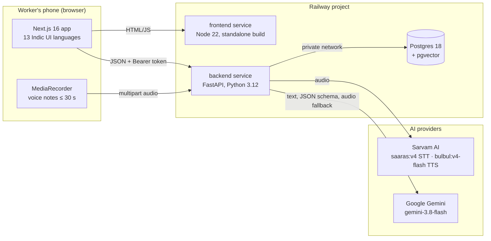
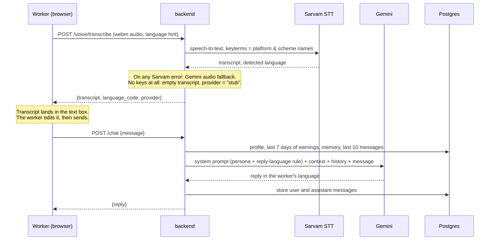
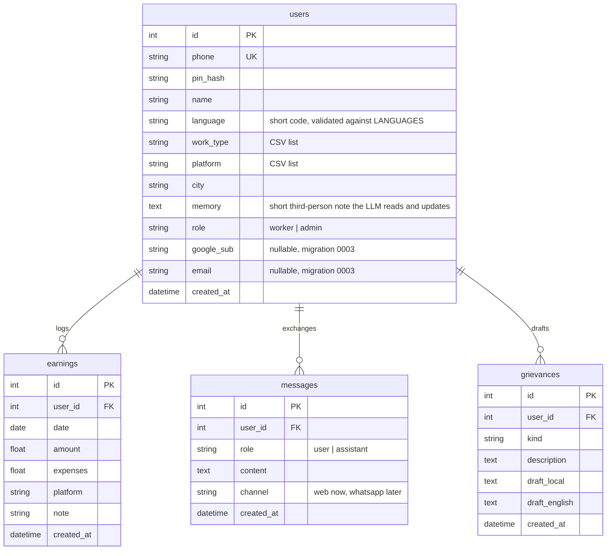

# Architecture

Saathi is a monorepo with two deployable services and a managed Postgres, all on Railway. The frontend is a mobile-first Next.js app; the backend is a FastAPI service that owns the data model, the language rules and every call to an AI provider.

## System diagram



## Request flow: a voice note in chat



The transcript is always shown and editable before it is sent. That is deliberate: the worker sees what was heard, the LLM gets clean text, and tests can mock a string instead of an audio file.

## Data model



Migrations are managed by Alembic (`backend/alembic/`): `0001` initial schema, `0002` indexes on foreign keys and timestamps, `0003` Google sign-in columns.

## How context is built

Every LLM call for a worker goes through `app/context.py`:

1. **Profile**: name, work types, platforms, city, language.
2. **Memory**: a few sentences in English that the onboarding parser writes and later conversations update. Example: "Delivers for Zomato and Swiggy in Jaipur, mostly night shifts, three years of experience."
3. **Earnings**: the last seven days as a list plus totals, so answers can cite real numbers.
4. **Reply-language rule**: `languages.reply_instruction(code)` adds one explicit sentence naming the language and script ("Reply in தமிழ் (Tamil), written in its own native script…").

The system prompt sets the persona (practical, short sentences, never invents legal facts, gives emergency numbers for safety questions) and states that user content is data, not instructions. The same context feeds chat, earnings parsing, onboarding extraction and grievance drafting, which is what makes the flows connect: logged earnings become evidence in a complaint without the worker retyping anything.

## Language handling

- `backend/app/languages.py` is the single source of truth: 13 short codes with English name, native name, Sarvam BCP-47 code and whether TTS is available. `GET /languages` exposes it.
- `frontend/lib/i18n.ts` carries the UI chrome strings for the same 13 codes; a test checks every language has every key.
- The document `lang` and `dir` attributes follow the chosen language (`ur` is right-to-left).
- Speech-to-text auto-detects the language when no hint is given and can switch the UI to the detected language during onboarding.

## Stub and fallback behaviour

| Situation | Behaviour |
|---|---|
| No `GEMINI_API_KEY` | `llm.generate` returns a labelled placeholder; `extract_json` returns a stub dict. Every endpoint still responds. |
| Gemini call fails | A polite "try again" reply; JSON extraction returns `{}` and callers apply defaults. |
| No `SARVAM_API_KEY` or Sarvam error | Transcription falls back to Gemini native audio. |
| Neither speech provider | Empty transcript with `provider: "stub"`; the UI lets the worker type instead. |
| No `DATABASE_URL` | `/health` reports `database: false`; data endpoints return 503. |

## Deployment topology

- One Railway project, three services: `frontend`, `backend`, `Postgres`. Both app services build from the repo root with `RAILWAY_DOCKERFILE_PATH` selecting their Dockerfile, and deploy on every push to `main`.
- The backend reaches Postgres on the private network via `${{Postgres.DATABASE_URL}}`. The public TCP proxy exists only for local development and should be disabled otherwise.
- The frontend calls the backend's public URL; CORS on the backend allows only the frontend origin.
- Container start for the backend: `alembic upgrade head` then `uvicorn`. A failed migration stops the deploy before it serves traffic.
- `/health` checks a database round-trip and whether an LLM key is present.

### Environment variables

| Service | Variable | Purpose |
|---|---|---|
| backend | `DATABASE_URL` | Postgres connection (private URL on Railway) |
| backend | `SECRET_KEY` | Signs session tokens; the app refuses the default value in production |
| backend | `GEMINI_API_KEY` | Gemini; optional, enables stub mode when absent |
| backend | `SARVAM_API_KEY` | Sarvam speech; optional |
| backend | `GOOGLE_CLIENT_ID` | Verifies Google ID tokens; optional |
| backend | `CORS_ORIGINS` | Comma-separated allowed origins |
| backend | `ENVIRONMENT` | `development` or `production` |
| frontend | `NEXT_PUBLIC_API_URL` | Backend base URL, inlined at build time |
| frontend | `NEXT_PUBLIC_GOOGLE_CLIENT_ID` | Shows the Google button when set |

## Migration workflow

```bash
cd backend
uv run alembic revision --autogenerate -m "add ratings table"   # after editing app/models.py
uv run alembic upgrade head                                     # apply locally
uv run alembic downgrade -1                                     # roll back one step
```

Migrations run automatically at container start on Railway. The test suite applies them to SQLite, so a migration that cannot run fails CI.

## Design decisions

**Decoupled speech → text → LLM → speech instead of a native-audio model.** The transcript is visible and editable, token usage is text and therefore cheap and countable, each provider can be swapped independently, and tests mock strings. The cost is two extra hops of latency, which is acceptable for voice notes but not for a live call; a real-time mode would use Gemini Live later.

**Phone + PIN as the primary login.** The audience is on low-end Android, often without a stable email, and SMS OTP needs a paid provider and cannot be exercised by an automated evaluator. Google sign-in is offered as a second path because every Android phone has a Google account.

**One Railway project.** Services in one project share a private network, so the database is never exposed publicly for the app to work.

**CSV lists for work types and platforms.** A worker has a handful of values and the app only ever reads or replaces the whole list, so join tables add migrations and queries without a current benefit. The helpers in `app/util.py` are the single place to change if that stops being true.

**Gemini `gemini-3.8-flash` with thinking disabled.** Replies land in a few seconds, the free tier covers a demo, and the same model handles text, JSON extraction, images and audio.
